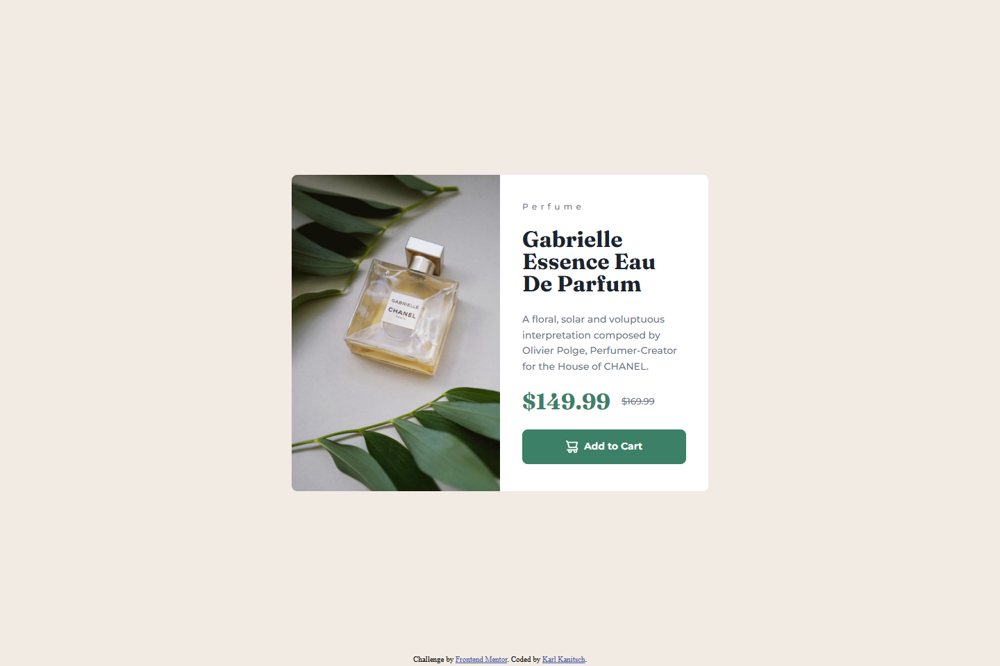
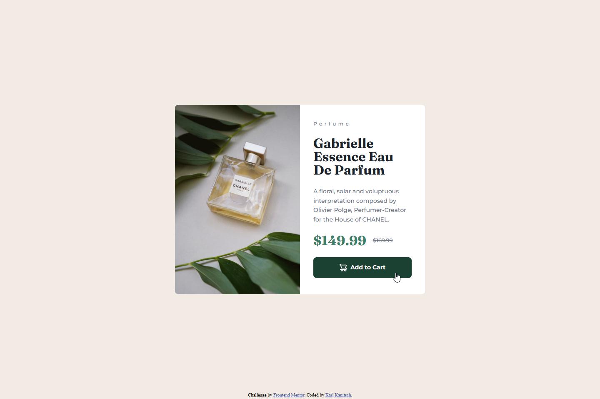

# Frontend Mentor - Product preview card component solution

This is a solution to the [Product preview card component challenge on Frontend Mentor](https://www.frontendmentor.io/challenges/product-preview-card-component-GO7UmttRfa). Frontend Mentor challenges help you improve your coding skills by building realistic projects. 

## Table of contents

- [Frontend Mentor - Product preview card component solution](#frontend-mentor---product-preview-card-component-solution)
	- [Table of contents](#table-of-contents)
	- [Overview](#overview)
		- [The challenge](#the-challenge)
		- [Screenshot](#screenshot)
		- [Links](#links)
	- [My process](#my-process)
		- [Built with](#built-with)
		- [What I learned](#what-i-learned)
		- [Useful resources](#useful-resources)
	- [Author](#author)

## Overview

While fundamentally an easier challenge than the ones I have building as part of the ["Getting Started on Frontend Mentor" learning path](https://www.frontendmentor.io/learning-paths/getting-started-on-frontend-mentor-XJhRWRREZd) I found it hard to get used to relying on media queries again. As a result this solution still includes many of the more modern responsive layout approaches. It should scale smoothly aside from a change of image source and main card layout at 750px.

The resultant component displays an image (sized appropriately for viewport size) along with a product details section including product details, price and an add to cart call to action button.

### The challenge

Users should be able to:

- View the optimal layout depending on their device's screen size
- See hover and focus states for interactive elements (the Add to Cart button should be a darker green when hovered or focused)

### Screenshot

- Normal Desktop View 
- Active / Hover State Desktop View 
- Tablet View  
  
- Mobile View  
  

### Links

- Solution URL: [GitHub Repository](https://github.com/kkanit22/FEM-2-1-product-preview-card)
- Live Site URL: [Live Site](https://kkanit22.github.io/FEM-2-1-product-preview-card/)

## My process

### Built with

- Semantic HTML5 markup
- CSS custom properties
- Flexbox
- Mobile-first workflow

### What I learned

I learned how to use the <picture> html element to easily change the source of an image based on the viewport size. Due to a typo this was not working at first which led to learn more about the element, particularly the importance of ordering your queries.

I also learned through my own implementations that using media queries does not mean you must have stylist jumps in the page, nor that you can't make your website still fully responsive within each breakpoint. While I could have created this page without the media queries in the css and the result would likely be easier to code and read, there are situations where the media queries might be unavoidable and knowing that I can seamlessly combine queries with more modern responsive functions in css will be very helpful.

### Useful resources

- [<picture> HTML picture element](https://developer.mozilla.org/en-US/docs/Web/HTML/Reference/Elements/picture) - MDN provides good details and some examples on how to use this element, prticularly with regard to syntax.
- [Stack Overflow: Media queries in Picture source aren’t kicking in reliably when min-width is used for each source](https://stackoverflow.com/questions/77783124/media-queries-in-picture-source-aren-t-kicking-in-reliably-when-min-width-is-use) - This discussion highlights the importance of correctly combining the order of your sources with the correct media query types to allow proper cascading of the style sheet.

## Author

- Frontend Mentor - [@kkanit22](https://www.frontendmentor.io/profile/kkanit22)